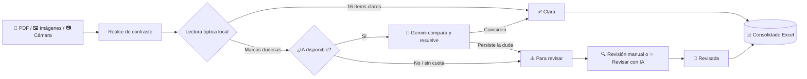

<div align="center">

# 📋 EncuestaScan

### Escáner inteligente del *Cuestionario de Autoestima Académica*

**Sube el PDF con todas las hojas escaneadas y obtén el consolidado en Excel en minutos.**
Lectura óptica local, gratuita y sin límites, con IA de Gemini solo cuando hace falta.

<br/>


<br/>

[✨ Funciones](#-funciones) •
[⚙️ Cómo funciona](#️-cómo-funciona) •
[🚀 Instalación](#-instalación) •
[📖 Uso](#-uso) •
[🧩 Estructura](#-estructura-del-proyecto) •
[🛠️ Problemas frecuentes](#️-problemas-frecuentes)

</div>

---

## 🎯 ¿Qué es?

**EncuestaScan** digitaliza las respuestas del **Instrumento N° 1 – Variable 1: Autoestima Académica** (16 ítems, escala de 1 a 5) usado en la investigación:

> *Relación entre autoestima académica y desempeño matemático en estudiantes de cuarto año de secundaria*
> — EESPP “Tarapoto”

Pasar a mano cientos de hojas toma horas y es fácil equivocarse. EncuestaScan **detecta las marcas (X) de cada hoja**, señala las dudosas para revisarlas y **genera un Excel listo para el análisis**.

---

## ✨ Funciones

<table>
<tr>
<td width="50%" valign="top">

### ⚡ Lectura óptica local (OMR)
Lee las marcas **directamente en tu navegador**: gratis, sin conexión, sin cuotas y en unos **0,1 s por hoja**. Endereza hojas inclinadas y detecta lapicero, lápiz tenue, ✓, círculos y X pequeñas.

</td>
<td width="50%" valign="top">

### 🤖 IA solo cuando hace falta
En modo híbrido, **Gemini solo revisa las hojas dudosas** y compara su lectura con la local. Si la IA no está disponible, la hoja queda para revisión manual y el lote **nunca se detiene**.

</td>
</tr>
<tr>
<td width="50%" valign="top">

### 📄 Escaneo masivo de PDF
Sube un PDF de varias páginas (o un lote de imágenes) y procesa **hoja por hoja** con barra de progreso, registro detallado y opción de detener.

</td>
<td width="50%" valign="top">

### 🔍 Revisión guiada
Filtra el lote por **Para revisar · Revisadas · Claras · Errores**, salta a la **siguiente pendiente** y resuelve cada hoja con el botón **✨ Revisar con IA**.

</td>
</tr>
<tr>
<td width="50%" valign="top">

### 🛡️ Tolerante a límites de la API
Detecta el error **429** de cuota, espera el tiempo indicado por Google, reintenta y permite **reintentar solo las hojas con error** más tarde.

</td>
<td width="50%" valign="top">

### 📊 Consolidado en Excel
Exporta un `.xlsx` con tres hojas: **Resumen por Ítem**, **Resumen por Dimensión** y **Registro por Estudiante**.

</td>
</tr>
<tr>
<td width="50%" valign="top">

### 📷 Cámara y fotos
Escanea con la cámara del celular o sube fotos. Incluye **realce de contraste** para hacer visibles las marcas a lápiz muy claras.

</td>
<td width="50%" valign="top">

### 💾 Todo queda guardado
Las fichas se guardan en el navegador y **sobreviven a recargas y reinicios**. Además de las marcas, se pueden editar nombre, grado y fecha.

</td>
</tr>
</table>

---

## ⚙️ Cómo funciona



### 🎚️ Modos de lectura

| Modo | Costo | Velocidad | Ideal para |
|:--|:--:|:--:|:--|
| ⚡ **Local + IA para dudosas** *(recomendado)* | Mínimo | 🟢 Rápido | Lotes grandes con pocas solicitudes a la API |
| 🖥️ **Solo lectura local** | **Gratis** | 🟢 Muy rápido | Sin internet o sin clave de API |
| ✨ **Solo IA** | 1 solicitud por hoja | 🟡 Lento | Fotos difíciles o cuando se necesitan los nombres manuscritos |

### 🔬 ¿Cómo lee las marcas sin IA?

1. **Endereza** la hoja estimando su inclinación (hasta ±5°).
2. **Ubica la banda azul** del encabezado de la tabla y la usa como ancla.
3. Con la geometría fija de la plantilla, **localiza las 80 casillas** (16 ítems × 5 columnas).
4. **Mide la tinta** de cada casilla y la compara con las demás de la fila y con el fondo de la hoja.
5. Asigna una confianza **alta / media / baja** y deja observaciones como *“Posible doble marca”* o *“Marca tenue”*.

> 💡 **Ninguna lectura dudosa se da por buena:** todo lo que no tiene confianza alta queda marcado para revisión.

---

## 🚀 Instalación

### Requisitos

- [Node.js](https://nodejs.org/) **22** o superior
- *(Opcional)* Una clave de API de Gemini, gratuita en [Google AI Studio](https://aistudio.google.com/apikey)

### Pasos

```bash
# 1. Clonar el repositorio
git clone https://github.com/gustav0-ri0s/EncuestaScan.git
cd EncuestaScan

# 2. Instalar dependencias
npm install --legacy-peer-deps

# 3. Crear el archivo de configuración
cp .env.example .env
```

Edita `.env` y coloca tu clave:

```env
GEMINI_API_KEY="tu-clave-de-gemini"

# Opcional: cambiar el modelo de Gemini (por ejemplo, uno Flash-Lite rinde más en el plan gratuito)
# GEMINI_MODEL="nombre-del-modelo"
```

```bash
# 4. Iniciar la aplicación
npm run dev
```

Abre **http://localhost:3000** en tu navegador. 🎉

> 🔐 El archivo `.env` está en `.gitignore`: **tu clave nunca se sube al repositorio.**
> Sin clave, la app funciona igual en modo **Solo lectura local**.

---

## 📖 Uso

1. **Elige el modo de lectura.** *Local + IA para dudosas* es el recomendado.
2. **Sube el PDF** con todas las fichas escaneadas, o usa la cámara o fotos sueltas.
3. **Observa el progreso.** Cada hoja queda como ✅ *Clara*, ⚠️ *Para revisar* o ❌ *Error*.
4. **Revisa las pendientes.** Filtra por *Para revisar*, abre cada hoja y:
   - corrige a mano tocando los botones 1–5, o
   - pulsa **✨ Revisar con IA** para que Gemini resuelva los ítems dudosos.
5. **Guarda.** La hoja pasa a 📝 *Revisada*.
6. **Exporta** el consolidado con **Exportar Excel**.

> 🖨️ La plantilla oficial en PDF está en la app (enlace **Plantilla PDF**) y en
> `public/assets/aistudio/`. Imprímela tal cual: la lectura local depende de su diseño.

---

## 🧩 Estructura del proyecto

```
EncuestaScan/
├── server.ts                    # Servidor Express: API de Gemini y exportación a Excel
├── src/
│   ├── App.tsx                  # Flujo principal: lotes, modos, reintentos
│   ├── components/
│   │   ├── BatchScanProgress.tsx   # Progreso del lote, filtros y reintentos
│   │   ├── ScanVerifier.tsx        # Revisión de hoja + "Revisar con IA"
│   │   ├── ScanModeSelector.tsx    # Selector de modo de lectura
│   │   ├── CameraScanner.tsx       # Cámara, imágenes y PDF
│   │   ├── ConsolidatedTable.tsx   # Consolidado por dimensión e ítem
│   │   └── ScannedSheetsList.tsx   # Listado de fichas
│   ├── utils/
│   │   ├── omrCore.ts           # 🔬 Motor de lectura óptica (sin DOM, testeable)
│   │   ├── omrReader.ts         # Puente navegador ↔ OMR y combinación con la IA
│   │   ├── imageEnhancer.ts     # Realce de contraste adaptativo
│   │   └── pdfExtractor.ts      # Renderizado de páginas PDF (pdf.js)
│   └── data/questionnaire.ts    # Ítems, dimensiones, indicadores y escala
└── public/assets/               # Plantilla oficial del cuestionario
```

### 📜 Scripts

| Comando | Descripción |
|:--|:--|
| `npm run dev` | Inicia el servidor de desarrollo en el puerto 3000 |
| `npm run build` | Genera la versión de producción |
| `npm run lint` | Verifica los tipos con TypeScript |

---

## 🛠️ Problemas frecuentes

<details>
<summary><b>❌ “You exceeded your current quota” (error 429)</b></summary>

<br/>

Tu clave de Gemini alcanzó el límite del plan gratuito. Opciones:

- Usa el modo **Local + IA para dudosas** o **Solo lectura local**.
- Configura un modelo Flash-Lite en `GEMINI_MODEL`, que tiene más solicitudes diarias.
- Activa la facturación en Google AI Studio.
- Usa **Reintentar errores** cuando la cuota se renueve.

</details>

<details>
<summary><b>❌ “API key not valid”</b></summary>

<br/>

Revisa que `.env` tenga tu clave real (no `MY_GEMINI_API_KEY`) y **reinicia el servidor**: la clave solo se lee al arrancar.

</details>

<details>
<summary><b>❌ <code>npm install</code> falla con ERESOLVE</b></summary>

<br/>

Usa `npm install --legacy-peer-deps`. Es un conflicto de versiones de `esbuild` con Vite 8 que no afecta el funcionamiento.

</details>

<details>
<summary><b>⚠️ “No se encontró el encabezado de la tabla de ítems”</b></summary>

<br/>

La lectura local no ubicó la tabla: la página está cortada, muy torcida (más de 5°), con perspectiva fuerte (foto de celular) o no es el cuestionario. En modo híbrido esas hojas pasan a la IA; si no, revísalas a mano.

</details>

<details>
<summary><b>🔒 El botón “Revisar con IA” aparece desactivado</b></summary>

<br/>

Las imágenes en tamaño completo solo se conservan mientras la página está abierta. Si recargaste la página, vuelve a escanear esas hojas.

</details>

---

## 👥 Créditos

<div align="center">

**Proyecto de investigación — EESPP “Tarapoto” · Promoción 2026**

👩‍🎓 **Cristell Angélica López Solís** · 👨‍🎓 **Gustavo Eduardo Ríos Quevedo**

🎓 Asesor: **Mag. Luis Enrique Javier Guanilo**

<br/>

*Hecho con 💙 para que investigar sea más fácil que digitar.*

</div>
